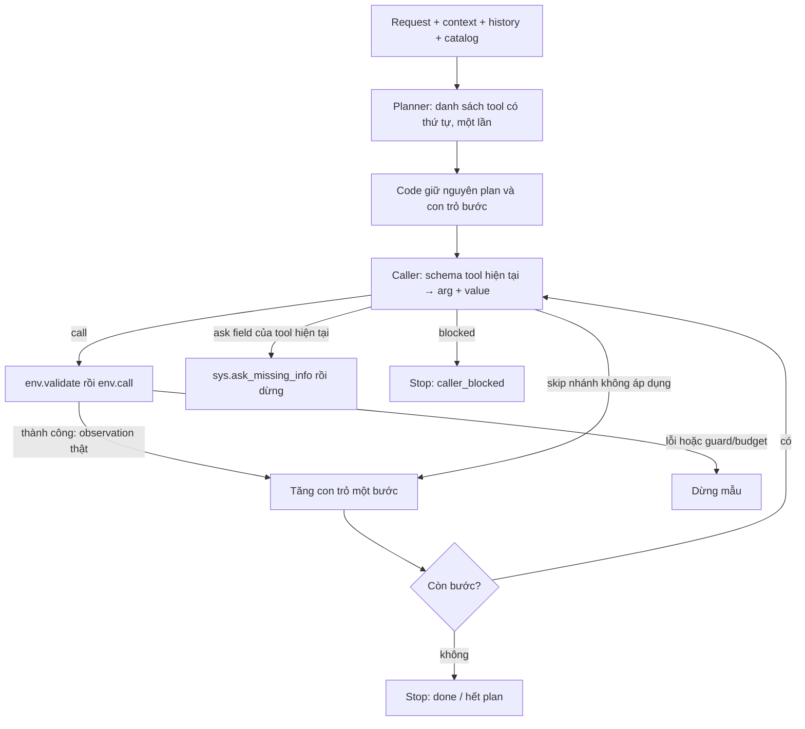

# Baseline v5 — planner chọn tool và thứ tự → caller điền arg + value

V5 được viết lại với hai vai trò dùng cùng Qwen checkpoint:

1. **Planner chạy một lần**, chọn danh sách tool theo thứ tự cho toàn bộ yêu cầu.
2. **Caller chạy theo từng vị trí**, chọn arguments và values cho tool mà planner đã ấn định.

Code giữ nguyên thứ tự, không sort hay deduplicate danh sách. Caller không chọn lại tool và không trả `done`. Kết quả ToolEnv của bước trước cung cấp dữ kiện cho bước sau. Không có summarizer, reviewer, replan hoặc retry; không sinh reason/note/issue hay instruction ở cấp điều khiển. Nội dung tin nhắn/ghi chú trong arguments vẫn là dữ liệu tác vụ được phép sinh.

Bản v5 trước là **tập tool không thứ tự**, caller tự chọn tool tiếp theo. Contract cũ đã được thay thế; output cũ có `name` hoặc `done` từ caller sẽ bị từ chối. Các baseline khác được giữ nguyên và không được import làm dependency.

## Workflow



Mỗi phần tử `tools` là **một vị trí gọi**, nên tên có thể lặp khi cần xử lý nhiều đối tượng. Code chỉ tăng `step_index` sau call thành công hoặc skip. Không được gọi nhiều lần ngoài các slot planner đã tạo.

Với nhánh runtime, planner đặt lookup trước các bước phụ thuộc và có thể đưa các bước của cả hai nhánh vào plan. Caller dùng kết quả thật để thực hiện nhánh áp dụng và skip nhánh còn lại. Plan chỉ chứa tên tool, không có biểu thức điều kiện hay mô tả bước; diễn giải đối tượng/nhánh vẫn là trách nhiệm của model từ request và trajectory.

## Contract hai node

Prompt ở [agent.py](agent.py), schema decoder ở [output_contracts.py](output_contracts.py), điều phối ở [agent_pipeline.py](agent_pipeline.py).

Input chung:

| Field | Format và ý nghĩa |
|---|---|
| `request` | String: yêu cầu hiện tại; gold text ở workflow mode, ASR text ở baseline mode |
| `context` | Object: thời gian, múi giờ, hồ sơ được cấp; loại `installed_apps` và state bên trong nó |
| `history` | Array: các lượt hội thoại/tool results trước request, không tự tạo lại nhiệm vụ cũ |
| `remaining_tool_calls` | Integer: số env.call còn lại; skip không tiêu thụ ngân sách này |

Không đưa label/gold calls/final_state hoặc observation tương lai vào model. Catalog chỉ lấy tên tool thuộc app được cấp. Các metric dùng nhãn chỉ chạy offline sau inference.

### Planner — chọn danh sách và thứ tự

Input thêm:

- `available_tools`: catalog rút gọn với name/kind/description/input_fields/required/x-one-of/returns.
- `max_plan_steps`: số slot tối đa, độc lập với budget env.call và budget tổng requests.

Planner chưa nhận env_feedback vì chỉ chạy trước lần gọi tool đầu tiên. Output:

```json
{"tools":["<tool ở bước đầu>","<tool ở bước tiếp theo>"]}
```

Hoặc:

```json
{"tools":[]}
```

Chỉ một key `tools`; array có thứ tự, chỉ tên khả dụng, được lặp. Không có argument/value/task description/reason. `sys.ask_missing_info` không nằm trong plan nghiệp vụ: caller có thể yêu cầu hỏi thông tin cho tool hiện tại qua contract riêng.

Plan rỗng dừng ngay, không gọi caller. Planner phải đặt lookup trước write và chọn đủ các hành động nối tiếp. Code không tự bổ sung tool còn thiếu.

### Caller — chỉ điền cho tool hiện tại

Input thêm:

| Field | Format và ý nghĩa |
|---|---|
| `tool_plan` | Array string: toàn bộ danh sách gốc, giữ cả thứ tự và phần tử lặp |
| `step_index` | Integer từ 0: vị trí hiện tại |
| `selected_tool` | Object: schema đầy đủ của đúng `tool_plan[step_index]`; không gửi full catalog cho caller |
| `env_feedback` | Array các response thật của env.validate/env.call đã diễn ra, theo thứ tự |
| `step_results` | Array metadata `{step_index, tool, status}` do code ghi; status là executed/skipped |

`step_results` chỉ là tiến độ điều phối, không phải bằng chứng về giá trị/nhánh. Một skip do model chọn không trở thành observation môi trường. Kết quả call gốc nằm trong env_feedback, không được thay bằng lời tóm tắt của model.

Caller trả đúng một trong bốn dạng:

```json
{"type":"call","arguments":{"<input field>":"<value đúng type>"}}
```

Không có field cần truyền:

```json
{"type":"call","arguments":{}}
```

Nhánh không áp dụng hoặc chính hành động đã hoàn tất:

```json
{"type":"skip"}
```

Thiếu hoặc mơ hồ input cần thiết:

```json
{"type":"ask","params":["<input field thật của tool hiện tại>"]}
```

Không thể xử lý đúng bước hiện tại, không có field phù hợp để hỏi:

```json
{"type":"blocked"}
```

- **call:** code tự gắn `name=tool_plan[step_index]`. Caller chọn tất cả required, đủ ít nhất một nhóm x-one-of (OR giữa các nhóm, AND trong nhóm), optional cần thiết và values. Không tự thêm default hay filter làm đổi phạm vi.
- **skip:** tăng con trỏ, không gọi env, không tạo response giả. Không được dùng skip để che thiếu dữ kiện hoặc nhảy tới lookup đặt sau.
- **ask:** code gắn `tool_name` bằng tool hiện tại rồi gọi sys.ask_missing_info thật. params chỉ chứa tên field hợp lệ, không trùng, không rỗng. Sau ask, mẫu dừng chờ user.
- **blocked:** dừng `caller_blocked`, không thực thi và không quay lại planner.

Không cho phép `name`, `tool_name`, `done`, `reason`, `note`, `issue`, `instruction` ở cấp điều khiển của caller. Nếu có field nghiệp vụ tên note/name trong schema tool, nó vẫn được phép ở **bên trong arguments**.

## Kiểm tra và dừng

Decoder vLLM mặc định dùng guidance. Schema caller được tạo riêng cho tool hiện tại, ràng buộc required/type/enum/x-one-of và đóng field ngoài schema. Code kiểm JSON đầy đủ, key trùng, NaN/Infinity, tên tool lạ, độ dài plan và field ask.

Sau call:

1. env.validate trước khi thực thi; lỗi dừng `validation_failed`.
2. Chặn write giống hệt một write đã thành công.
3. env.call thực thi; ok=false hoặc done=false dừng `tool_failed`.
4. Call thành công cung cấp response thật và chuyển slot; read lặp bị giới hạn bởi guard.

Hết danh sách dừng `done` bằng code, **không có lượt Qwen riêng để quyết định done**. Đây là hoàn tất duyệt plan, không phải verifier chứng minh đã làm đủ request. Planner bỏ sót một hành động thì vẫn có thể hết plan; caller skip sai cũng có thể gây thiếu việc.

Budgets:

- `--max-plan-steps` (24): giới hạn số slot đầu ra planner; có thể gồm slot sẽ skip.
- `--max-tool-calls` (10): tổng env.call thực thi, kể cả ask; validate/skip không tính.
- `--max-decisions` (24): tổng planner + caller requests. Budget này có thể dừng trước khi hết plan.
- `--max-no-progress` (2): giới hạn read lặp sau khi đã có cùng observation.

Caller vẫn được xét skip khi env.call budget bằng 0. Nếu còn cần call/ask thì code dừng `tool_limit`, không ép skip hoặc plan rỗng bằng grammar. Lỗi hạ tầng/grammar/context vượt giới hạn làm experiment aborted, không tạo summary thành công giả.

Khi prompt dài, code bỏ history cũ rồi feedback cũ, giữ request, plan, schema hiện tại và response mới nhất; `context_trimmed` ghi nhận mất ngữ cảnh. Không dùng bộ tóm tắt sinh bởi Qwen.

## Chạy Kaggle và CLI

Mở [kaggle_runner.ipynb](kaggle_runner.ipynb), bật GPU/Internet, attach dữ liệu và toàn bộ baseline_v5. Notebook đã thêm budgets cho ordered plan:

```python
MODE = "workflow"
INFERENCE_WORKERS = 4
VLLM_MAX_NUM_SEQS = INFERENCE_WORKERS
MAX_PLAN_STEPS = 24
MAX_TOOL_CALLS = 10
MAX_DECISIONS = 24
STRUCTURED_OUTPUTS = True
SAVE_NODE_INPUTS = False
```

```bash
python baseline_v5/run.py --mode workflow --data-root train+public_test \
  --limit 50 --seed 42 --inference-workers 4 --vllm-max-num-seqs 4 \
  --max-plan-steps 24 --max-tool-calls 10 --max-decisions 24 \
  --output-dir lifemate_baseline_v5_ordered
```

Giữ các mode asr/workflow/baseline/all, run_one và batch inference. Dùng output-dir mới để không ghi đè report của v5 cũ. `run_config.json` và summary ghi `architecture=ordered_tool_plan_caller`, `tool_order=fixed_by_planner`, `caller_tool_choice=false` và workflow fingerprint.

Mỗi mẫu giữ ToolEnv, plan, con trỏ và schema riêng. Batch chỉ gom các node requests đang sẵn sàng giữa các mẫu độc lập. workers=1 đo latency riêng; workers>1 đo throughput. Với N slot xử lý hết, cần 1 planner + N caller requests; không có lượt done cuối. Chưa có thực nghiệm GPU chứng minh tăng tốc hoặc độ chính xác.

## Report và dữ liệu huấn luyện

- Trace lưu planner_output, tool_plan, step_index, selected_tool, caller_output, action do code ghép và response thật.
- `selected_tools` vẫn được lưu như tập tên duy nhất, giữ thứ tự xuất hiện đầu, để đọc thống kê coverage; **không dùng nó để điều khiển execution**.
- `plan_step_count`: số slot, tính phần tử lặp.
- `processed_steps`: số slot đã call thành công hoặc skip; `skipped_steps`: phần đã skip.
- `tool_set_recall`: coverage tên tool nghiệp vụ gold, bỏ qua thứ tự/số lần.
- `tool_order_recall`: độ dài LCS giữa tool_plan và gold tool-name sequence / số gold calls nghiệp vụ, có tính lặp.
- `tool_plan_exact_match`: chuỗi tên tool đúng bằng gold nghiệp vụ.

Các diagnostic plan dùng nhãn train chỉ tính offline, không đưa vào prompt. Plan chứa cả nhánh runtime có thể không exact-match gold dù nhánh thực thi đúng. Thứ tự read khác nhưng tương đương cũng có thể giảm diagnostic; không dùng nó thay score_proxy/hash/audit nghiệp vụ. Proxy vẫn là metric local xấp xỉ, không phải điểm leaderboard.

[analyze_results.ipynb](analyze_results.ipynb) hiển thị các metric mới và trace hai node. Bật `--save-node-inputs` để lưu input_messages chính xác; không tự tạo nhãn, lọc trajectory hoặc fine-tune.

## Kiểm thử và giới hạn

```bash
python -m pip install matplotlib jsonschema 'llguidance>=1.3,<1.4'
python -m unittest discover -s baseline_v5 -p 'test_*.py' -v
```

Tests CPU dùng model giả lập và ToolEnv thật, gồm thứ tự không bị sort, tool lặp, caller không đổi tool/done sớm, lookup trước value, skip/ask/blocked, required/x-one-of, budgets, lỗi không retry, batch isolation, decoder compilation và report. Đây là kiểm tra implementation, không phải kết quả chất lượng Qwen.

Giới hạn của plan cố định:

- Chọn sai/thiếu tool hoặc thứ tự sai thì caller không thể chèn lookup hay replan.
- Số đối tượng chỉ biết sau lookup có thể vượt số slot planner đã tạo; chưa hỗ trợ vòng lặp/foreach.
- Không có nhãn mục tiêu hoặc guard có cấu trúc cho từng slot; các slot trùng tool ở nhiều nhánh có thể mơ hồ.
- Skip và values vẫn do model quyết định. Schema hợp lệ không chứng minh đúng người, ID, điều kiện hay nội dung; env cũng có thể chấp nhận một ID sai.
- Không có recovery sau lỗi env, và hết plan không chứng minh đủ ý định user.
