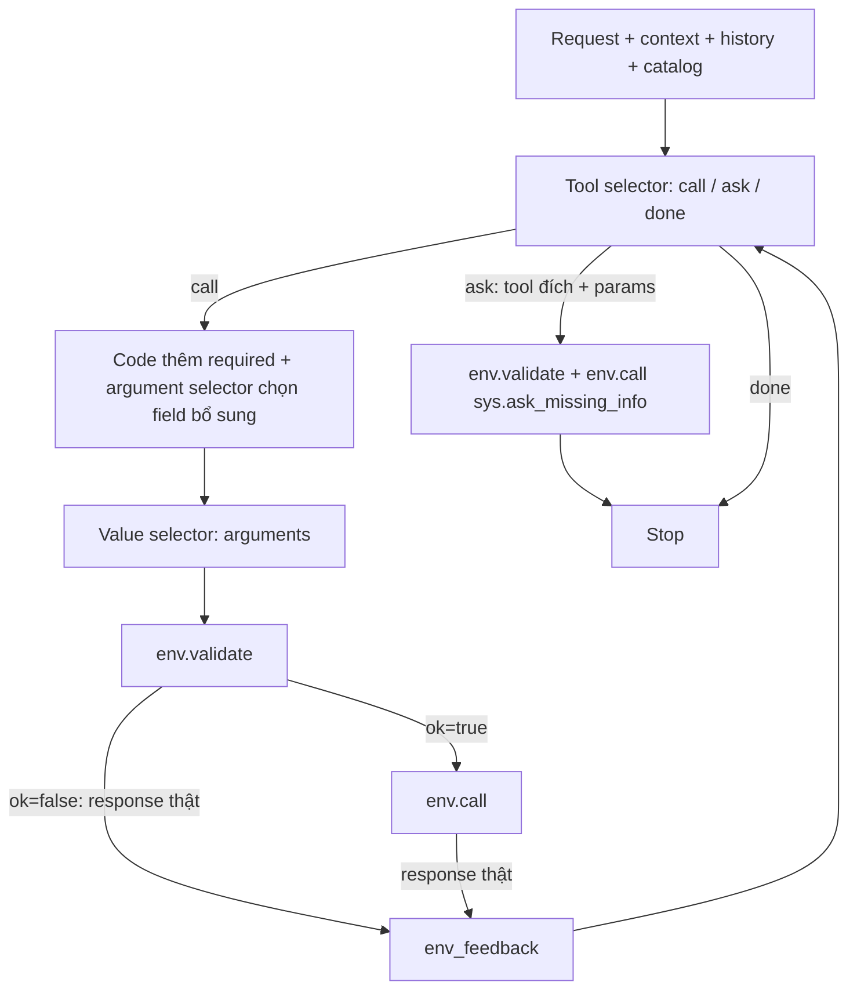

# LifeMate baseline v3

Biến thể độc lập từ `baseline_v2`: **tool selector → argument selector → value selector → ToolEnv**. Planner chỉ còn chọn tool/bước tiếp theo. Cả ba node chỉ trả JSON theo contract, không trả lời giải thích, goal, task description, reason, note, source hay issue ở cấp điều khiển.

Chỉ **response thật của `env.validate` và `env.call`** được đưa lại model làm feedback. `baseline_v2` không bị thay đổi. v3 không import module của v2.

## Workflow



Code bỏ qua argument selector nếu không có field ngoài required; bỏ qua value selector nếu tập field cuối cùng rỗng. Một lượt có thể chỉ cần tool selector; không bắt mọi tool đi qua đủ ba lần gọi Qwen.

## Contract ba node

Prompt nằm ở `agent.py`, dùng sáu phần Context / Objective / Style / Tone / Audience / Response. Schema decoder nằm ở `output_contracts.py`; code thực thi ở `agent_pipeline.py`.

Input chung là một JSON object:

| Trường | Nội dung |
|---|---|
| `request` | Transcript hiện tại; workflow mode dùng gold text, baseline mode dùng ASR |
| `context` | Context được cấp, bỏ toàn bộ `installed_apps` để không đưa state ẩn vào prompt |
| `history` | Hội thoại trước yêu cầu này và tool results có sẵn, rút gọn từ dataset |
| `env_feedback` | Các lần validate/call thực tế trong session này, theo thứ tự |
| `remaining_tool_calls` | Số lượt env.call còn lại |

Không đưa `label`, gold tool calls, gold final state, state nội bộ của simulator hoặc trace giải thích của Qwen vào input. Catalog khả dụng được lấy từ danh sách tool của các app được cấp.

### Tool selector

Input bổ sung: `available_tools`, gồm tên, kind, description, input_fields, required, x-one-of và returns. Đây là catalog rút gọn; hai node sau nhận schema đầy đủ của tool được chọn.

Chỉ một trong ba output:

```json
{"type":"call","name":"<tool khả dụng>"}
```

```json
{"type":"ask","tool_name":"<tool đích>","params":["<field thật của tool đích>"]}
```

```json
{"type":"done"}
```

`call` chọn một tool; không sinh arguments ở node này. `ask` được code chuyển thành `sys.ask_missing_info`, không có câu hỏi tự do. `done` dừng session. Không còn plan/revise/completed_goals hay bộ kiểm goal của v2; model phải đối chiếu request và kết quả thật trước khi done.

### Argument selector

Input bổ sung: `selected_tool` (schema đầy đủ), `required_arguments` (code tự thêm).

```json
{"selected_arguments":["<field bổ sung>"]}
```

```json
{"selected_arguments":[]}
```

Model chỉ chọn field ngoài required: field để thỏa x-one-of và optional cần cho yêu cầu. Code ghép `required + selected_arguments` theo thứ tự, không bắt model phân loại required hoặc sinh reason. OR giữa các nhóm x-one-of, AND giữa các field trong cùng một nhóm. Chọn nhóm nào phụ thuộc request/dữ kiện, không phải lúc nào cũng chọn nhóm đầu tiên. `[]` hợp lệ khi không cần bổ sung.

Tên phải thuộc properties cấp ngoài của tool, không trùng, không thuộc returns. Việc đủ required/x-one-of theo **giá trị** do env.validate quyết định.

### Value selector

Input bổ sung: `selected_tool`, `selected_arguments` (tập field cuối sau khi code thêm required).

```json
{"arguments":{"<field đã chọn>":"<value đúng type>"}}
```

Nếu không biết một giá trị, **bỏ field đó**, không sinh issue, không đặt sentinel, không đoán dữ kiện:

```json
{"arguments":{}}
```

Model có thể trả một phần các field. Thiếu required hoặc thiếu một nhóm x-one-of sẽ sinh lỗi thật từ env.validate, tool selector nhận lỗi và chọn lookup/ask phù hợp. Giá trị task như nội dung SMS, tiêu đề hoặc nội dung ghi chú vẫn là chuỗi được phép sinh **bên trong arguments**, nếu tool/request yêu cầu. Bỏ reason/note của agent không có nghĩa bỏ nội dung mà người dùng muốn gửi hoặc lưu.

## Feedback: chỉ từ môi trường

Mỗi phần tử có dạng:

```json
{"stage":"validate hoặc call","tool":"<tên tool>","arguments":{},"response":{}}
```

`response` là bản sao nguyên vẹn kết quả API tương ứng, không được Qwen viết lại hoặc code thêm suggested_lookup/candidates/checklist. Arguments là dữ liệu của lần validate/call đó. Response có thể chứa message/error bằng văn bản do **env** trả về; v3 giữ nguyên cả `ok=true, done=false`.

Sau validation hợp lệ, env.call thực thi và trả kết quả. Validation lỗi không thực thi tool và không tiêu thụ lượt env.call. Tool selector nhìn các kết quả này để quyết định bước tiếp theo; không có reviewer, grounding LLM, issue router, intent checklist, semantic repair hoặc tự sửa bằng văn bản Qwen.

`history` vẫn có lời assistant lịch sử nếu dataset cung cấp; đó là ngữ cảnh ban đầu, không phải một reviewer hay feedback mới do model đang chạy sinh ra. Output JSON của các selector được chuyển tiếp để thực thi hành động, không chuyển reason/note vào feedback.

## Code còn kiểm gì?

- Decoder vLLM mặc định dùng JSON schema với guidance: tên tool/field là tập enum đóng, không có key giải thích ngoài contract.
- Parser yêu cầu một object JSON hoàn chỉnh, cấm key trùng, NaN/Infinity và văn bản ngoài JSON. Code kiểm tên field, key ngoài contract và phần tử lặp.
- `env.validate` kiểm schema, rồi `env.call` thực thi nghiệp vụ.
- Giới hạn tool calls/decisions, lỗi validate liên tiếp, read lặp và tool thất bại để dừng vòng lặp. Chặn một write giống hệt đã thành công để tránh lặp tác động. So sánh arguments không phụ thuộc thứ tự key.

Vi phạm contract hoặc chặn duplicate write sinh `local_diagnostic` là **mã log của code**, dừng mẫu và không được gửi lại model dưới dạng feedback. Budget stop tương tự. Lỗi hạ tầng/grammar/context vượt ngân sách không bị ngụy trang thành lỗi môi trường: runner đánh dấu experiment `aborted`, giữ partial trace và không xuất summary thành công.

`max_repairs` giờ giới hạn các lần thử sau lỗi thật của env, không gọi một node repair. Không có bước bổ sung Qwen ngoài ba selector.

Khi quá context, code bỏ dần history cũ rồi feedback cũ, giữ nguyên request/schema và ít nhất feedback mới nhất. Response còn giữ được không bị tóm tắt. `context_trimmed=true` ghi nhận việc này; mất quan sát cũ vẫn có thể ảnh hưởng quyết định của model.

## Chạy trên Kaggle

Mở `kaggle_runner.ipynb`, bật GPU/Internet, attach dữ liệu và thư mục `baseline_v3`. Notebook mặc định `MODE="workflow"`, chạy 50 mẫu bằng gold transcript. Thay `MODE` nếu cần ASR hoặc toàn bộ pipeline.

```python
MODE = "workflow"
INFERENCE_WORKERS = 4
VLLM_MAX_NUM_SEQS = INFERENCE_WORKERS
STRUCTURED_OUTPUTS = True
```

Các mẫu có session riêng; batch gom request sẵn sàng của các node, mỗi request giữ prompt và schema riêng. Batch tăng throughput tùy GPU/prompt; không bảo đảm giảm latency riêng. Dùng workers=1 để đo latency riêng, giữ cùng cấu hình khi so sánh chất lượng. Profile mặc định giữ float16/TRITON_ATTN/TP=1; có thể đổi trong notebook. Dependency và adapter inference giữ theo v2.

CLI từ thư mục dự án:

```bash
python baseline_v3/run.py --mode workflow --data-root train+public_test \
  --limit 50 --seed 42 --inference-workers 4 --vllm-max-num-seqs 4 \
  --output-dir lifemate_baseline_v3
```

`--mode asr`: chỉ ASR; `--mode workflow`: gold text → workflow; `--mode baseline`: ASR → workflow; `--mode all`: cả ba và so sánh ASR. `run_one.py <train_id>` chạy riêng một mẫu. `--llm-backend transformers` chạy tuần tự, parser vẫn kiểm contract nhưng không có constrained decoding; mặc định nên dùng vLLM structured outputs. `--no-structured-outputs` chỉ dành cho thực nghiệm đối chứng.

## Output và kiểm tra

- `run_config.json`: seed, sample IDs, model/backend, architecture, feedback source, fingerprint code.
- `workflow_gold/` và `baseline_asr/`: predictions, traces, cases/errors CSV, summary/report, charts, run_status.
- Trace chứa `node_outputs` theo node: JSON output, token và latency; field skip nêu node không gọi. Không có task_plan/reasons hay metric reviewer của v2.
- `analyze_results.ipynb`: đọc metric, từng case và chi phí từng node.

Chạy CPU integration tests với dataset gốc ở cạnh folder:

```bash
python -m pip install matplotlib jsonschema 'llguidance>=1.3,<1.4'
python -m unittest discover -s baseline_v3 -p 'test_*.py' -v
```

Tests dùng scripted model và ToolEnv thật: end-to-end, required/zero-field skip, thiếu value → validation thật → lookup, business failure, ask, contract lỗi, giới hạn lặp, batch isolation, schema compilation và report writer. Đây là kiểm thử implementation, **chưa phải kết quả thực nghiệm Qwen v3 trên GPU**.

## Giới hạn của biến thể

Schema hợp lệ không chứng minh ID, nội dung, thời gian hoặc nhánh điều kiện đúng. Env có thể chấp nhận một giá trị hợp kiểu nhưng sai ý user, và thường không phát hiện optional quan trọng bị bỏ. Do chỉ dùng feedback môi trường, v3 không còn các bộ kiểm semantic/grounding/checklist của v2; done sớm và bịa value hợp schema vẫn là rủi ro cần đo lại. Prompt yêu cầu model lookup/không đoán, không bảo đảm model luôn tuân thủ. Guard duplicate write cũng không phân biệt được yêu cầu lặp có chủ đích với lặp do lỗi.

Mục tiêu của v3 là tạo contract tối giản để nghiên cứu/huấn luyện và so sánh. Chưa có căn cứ khẳng định score hay tốc độ tốt hơn v2 trước khi chạy cùng seed, sample IDs và cấu hình GPU.
