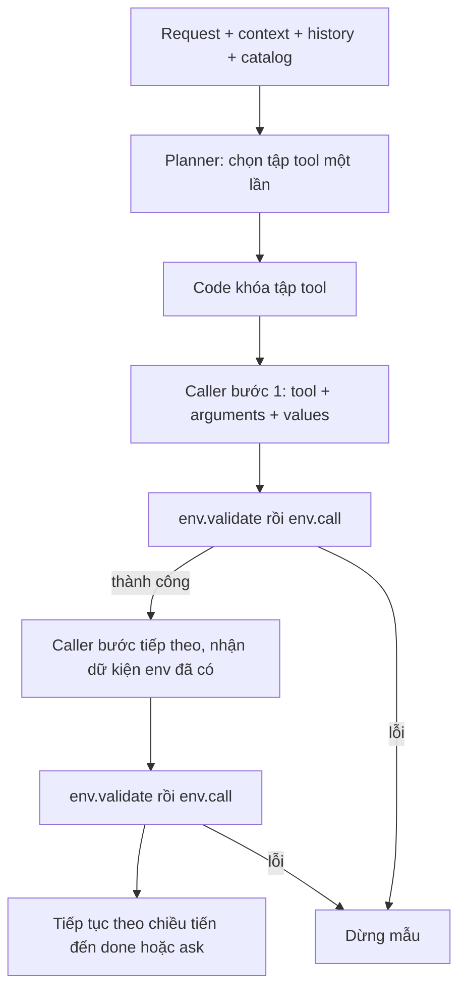

# Baseline v5: planner chọn tập tool → caller tạo lệnh gọi đầy đủ

V5 có **hai loại node Qwen**:

1. **Planner** chạy một lần, chọn tập tool cho toàn bộ yêu cầu.
2. **Caller** chọn tool tiếp theo trong tập, đồng thời chọn field và điền value trong một JSON output.

Không còn node argument selector/value selector riêng. Không có reason/note/issue/goal, reviewer, reflector, replan hoặc retry. Feedback chỉ từ ToolEnv thật. V2/v3/v4 được giữ nguyên; v5 không import các folder đó.

## Workflow



**Tập tool không có thứ tự.** Mảng output của planner chỉ là cách biểu diễn tập; code kiểm không trùng và sắp tên theo thứ tự chữ cái trước khi chuyển cho caller. Caller tự quyết định thứ tự thực thi theo dữ kiện runtime. Có thể dùng cùng một tool nhiều lần cho các đối tượng khác nhau, hoặc không dùng những tool thuộc nhánh điều kiện không áp dụng.

V5 thực thi nhiều bước: một lượt caller phát ra một lệnh, kết quả thành công cung cấp dữ kiện cho lượt tiếp theo. Đây không phải sinh tất cả arguments trước khi lookup chạy. Không có cạnh quay về planner và không có bước chạy lại để sửa một lệnh thất bại. Nếu muốn planner quyết định sẵn thứ tự thì đó là biến thể khác với tập tool ở đây.

## Input và output hai node

Prompt ở `agent.py`, schema decoder ở `output_contracts.py`, thực thi ở `agent_pipeline.py`.

Input chung:

| Field | Nội dung |
|---|---|
| `request` | Transcript hiện tại; workflow mode dùng gold text, baseline mode dùng ASR |
| `context` | Thời gian, múi giờ, hồ sơ được cấp; bỏ installed_apps/state nội bộ |
| `history` | Ngữ cảnh hội thoại/tool results ban đầu, không tự phát lại nhiệm vụ cũ |
| `remaining_tool_calls` | Số lần env.call còn lại; không phải số tên tool tối đa trong tập |

Không đưa label, gold calls, final_state, kết quả tool tương lai hoặc lời tự đánh giá của Qwen vào prompt. Tên tool khả dụng được lấy từ app được cấp; state ẩn không được dùng để điền value.

### Planner

Input thêm `available_tools`: catalog rút gọn gồm tên/kind/description/input_fields/required/x-one-of/returns. Planner không nhận feedback runtime vì chỉ chạy trước lần gọi tool đầu tiên.

Output duy nhất:

```json
{"tools":["<tên tool khả dụng>"]}
```

Hoặc `{"tools":[]}` khi request không cần tool. Tập rỗng làm code dừng với done, không gọi caller.

Planner phải chọn đủ lookup và hành động cần thiết. Khi điều kiện runtime chưa biết, có thể chọn tool cho các nhánh hợp lệ; caller chỉ thực hiện nhánh được thỏa mãn. Mỗi tên chỉ xuất hiện một lần, không có thứ tự/argument/value/task description. Không trả ask/done riêng ở node này.

### Caller

Input thêm:

- `selected_tools`: tập đã khóa từ planner, không phải thứ tự gọi.
- `available_tools`: schema đầy đủ của chính tập đó; không có schema của tool ngoài tập.
- `env_feedback`: danh sách các lần validate/call đã diễn ra thành công trước lượt này, giữ nguyên response thật.

Caller trả một trong ba dạng:

```json
{"type":"call","name":"<tool trong tập>","arguments":{"<input field>":"<value đúng type>"}}
```

```json
{"type":"ask","tool_name":"<tool đích trong tập>","params":["<tên field thật>"]}
```

```json
{"type":"done"}
```

Caller tự điền tất cả required, chọn đủ một nhóm x-one-of (OR giữa nhóm, AND trong nhóm), thêm optional cần cho yêu cầu. Không có `selected_arguments`, `argument_reasons` hoặc `value_reasons`; code không tự sinh value cho required. Tool không có tham số dùng arguments={}.

Chưa biết giá trị cần thiết thì chọn lookup trong tập. Nếu hết lookup hữu ích hoặc mục tiêu chưa phân biệt được, dùng ask; không bịa value, không thêm issue. Ask được code chuyển thành sys.ask_missing_info, chỉ có tool_name và tên field, không có câu hỏi tự do.

Caller chỉ done khi đã làm đủ hành động áp dụng, không phải khi đã dùng hết tập tool. Cần truyền nội dung tin nhắn/ghi chú thì chuỗi trong arguments vẫn được phép sinh, vì đó là dữ liệu tác vụ; chỉ loại bỏ lời tự giải thích của agent.

## Contract và quy tắc dừng

- Decoder vLLM mặc định dùng guidance. Schema call ràng buộc tên tool với **đúng arguments của tool đó**, đóng các field ngoài schema, required/type/enum và nhóm x-one-of. Không dùng uniqueItems không được backend hỗ trợ; kiểm trùng bằng Python.
- Code kiểm toàn bộ JSON, key trùng, NaN/Infinity, tên tool ngoài tập, argument ngoài schema và key giải thích ngoài contract.
- `env.validate` luôn chạy trước env.call. Lỗi validate dừng với validation_failed; không thực thi lệnh đó.
- Env.call trả ok=false hoặc done=false thì dừng với tool_failed; ok=true/done=false không bị coi là thành công.
- Không có retry, sửa arg/value, mở rộng tập hoặc gọi lại planner sau lỗi. Response lỗi nằm trong trace; vì mẫu dừng nên không có lượt caller tiếp theo nhận lỗi đó.
- Có budget tổng số lượt LLM/tool, dừng read lặp và chặn write giống hệt đã thành công. Local diagnostic là log code, không giả làm feedback env.
- Sau khi hết ngân sách env.call, caller vẫn có thể done. Nếu còn đề xuất call/ask thì code dừng tool_limit, không thực thi thêm. Không ép done bằng grammar để che tác vụ chưa xong.

Feedback chuyển sang lượt sau có dạng:

```json
{"stage":"validate hoặc call","tool":"<tool>","arguments":{},"response":{}}
```

Lỗi hạ tầng/grammar/context vượt ngân sách làm experiment aborted và không xuất summary thành công giả. Khi context dài, bỏ history cũ rồi feedback cũ, giữ request/schema/tập tool và feedback mới nhất; context_trimmed ghi nhận việc mất ngữ cảnh.

## Chạy Kaggle

Mở `kaggle_runner.ipynb`, bật GPU/Internet và attach dữ liệu cùng thư mục baseline_v5. Mặc định MODE=workflow, 50 mẫu, workers=1. Để lấy số liệu theo batch:

```python
MODE = "workflow"
INFERENCE_WORKERS = 4
VLLM_MAX_NUM_SEQS = INFERENCE_WORKERS
STRUCTURED_OUTPUTS = True
SAVE_NODE_INPUTS = False
```

```bash
python baseline_v5/run.py --mode workflow --data-root train+public_test \
  --limit 50 --seed 42 --inference-workers 4 --vllm-max-num-seqs 4 \
  --output-dir lifemate_baseline_v5
```

Giữ ASR/workflow/baseline/all, run_one, batch inference và adapter từ v4. Không còn --plan-mode/--max-repairs vì không có lựa chọn replan/repair. Mỗi mẫu có ToolEnv/tập tool riêng; batch gom request sẵn sàng của planner/caller với prompt và schema riêng.

Workers=1 dùng để đo latency riêng; workers>1 đo throughput. So các phiên bản bằng cùng model, seed, sample IDs, budgets, GPU và worker settings. Chưa có kết quả GPU chứng minh v5 nhanh hoặc chính xác hơn.

## Báo cáo và dữ liệu cho fine-tune

- `run_config.json`: architecture=planner_tool_set_caller, seed, sample IDs, model/backend, fingerprint.
- `traces.jsonl`: selected_tools, planner_calls/caller_calls và từng event plan/call. Không còn plan_mode, plans, replan, arg/val node output.
- `cases.csv`/`summary.json`: số tool đã chọn, số lượt planner/caller/LLM, latency, token, hash và score proxy.
- `tool_set_recall`: độ bao phủ **tên** tool trong nhãn train, không tính sys.ask_missing_info; bằng 1 nếu nhãn không có tool nghiệp vụ. Chỉ là diagnostic offline, không đánh giá đúng thứ tự/value, không gửi vào model. Tập lớn có thể recall cao nhưng vẫn gọi sai.
- `analyze_results.ipynb`: đọc metric, các case và chi phí hai node.

Nếu cần tạo dữ liệu huấn luyện, bật SAVE_NODE_INPUTS hoặc --save-node-inputs. Mỗi node_output sẽ có input_messages chính xác đã gửi model và text output gốc. Mặc định tắt vì có thể làm trace rất lớn. Chỉ lưu dữ liệu, không tự lọc trajectory, tạo nhãn hay fine-tune model; cần verifier phù hợp ở pipeline huấn luyện sau này.

## Kiểm thử và giới hạn

```bash
python -m pip install matplotlib jsonschema 'llguidance>=1.3,<1.4'
python -m unittest discover -s baseline_v5 -p 'test_*.py' -v
```

Tests CPU dùng model giả lập và ToolEnv thật, gồm: planner chỉ một lượt, pool không có thứ tự, caller điền toàn bộ lệnh và dùng lookup, chặn tool ngoài pool, required/x-one-of, lỗi dừng không retry, ask/done, budget, batch isolation, schema compilation và report writer. Tests không phải kết quả chất lượng Qwen.

Planner chọn thiếu tool thì caller không thể tự bổ sung. Caller phải làm nhiều việc hơn v3/v4, nên có thể tăng lỗi chọn field/value hoặc done sớm. Schema hợp lệ không chứng minh ID, nhánh, nội dung hoặc optional đúng ý user. Duplicate guard cũng không phân biệt được yêu cầu gửi lặp có chủ đích với lặp do lỗi. Các giới hạn này cần đo bằng thực nghiệm; thêm node hoặc vòng phản hồi không nằm trong v5 hiện tại.
