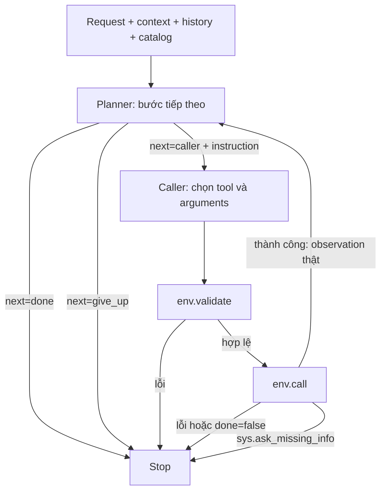

# Baseline v6 — planner chỉ dẫn bước tiếp theo, caller gọi tool

V6 chia hai vai trò theo hướng [α-UMi, mục 3.2](https://aclanthology.org/2024.emnlp-main.929.pdf#page=3): **planner quyết định bước tiếp theo → caller chọn tool và arguments → môi trường trả observation → planner quyết định bước sau**.

Planner không chọn tập tool một lần như v5 và không viết danh sách gọi cố định như v4. Nó sinh một instruction ngắn cho **một bước**. Caller tự chọn tool cùng toàn bộ arguments dựa trên instruction, request và quan sát thật.

V6 có vòng thực thi nhiều bước quay lại planner sau mỗi lần gọi thành công. Không có reflector, reviewer, vòng tự tạo dữ liệu/huấn luyện hoặc tự động retry sau lỗi env. Đây là biến thể mới; v2/v3/v4/v5 được giữ nguyên.

## Cấu trúc thư mục

```text
baseline_v6/
├── run.py                       # Entry point chạy thực nghiệm
├── run_one.py                   # Chạy riêng một train ID
├── README.md
├── src/lifemate_v6/
│   ├── pipeline.py              # Điều phối planner/caller và ToolEnv
│   ├── contracts.py             # Schema structured output
│   ├── prompts/
│   │   ├── planner.txt
│   │   └── caller.txt
│   ├── models.py                # Qwen/PhoWhisper, lazy imports
│   ├── batching.py              # Batch request giữa các mẫu
│   ├── runner.py                # CLI và các experiment mode
│   ├── common.py                # Dataset, metric và tiện ích chung
│   ├── reporting.py             # Report và chart
│   ├── reproducibility.py
│   └── errors.py
├── notebooks/
│   ├── kaggle_runner.ipynb
│   └── analyze_results.ipynb
├── requirements/                # vllm.txt, transformers.txt, test.txt
├── tests/                       # CPU integration tests
├── docs/                        # Workflow, kết quả kiểm tra implementation
└── outputs/                     # Output local mặc định, tạo khi chạy, gitignored
```

Chỉ hai script entry point nằm ở root. Package dùng relative imports nên không nhầm module với baseline cũ. Không cần cài package hoặc copy file rời; phải giữ nguyên src/ và prompt assets. Notebook và dependencies đã đổi sang đường dẫn mới. Không di chuyển các baseline cũ để tránh làm hỏng notebook/report hiện có.

## Workflow



Planner và caller là hai prompt/vai trò dùng cùng một Qwen checkpoint trong runner mặc định. Chưa có fine-tune hoặc hai checkpoint chuyên biệt.

## Contract hai node

Input chung là request/context/history, available_tools, env_feedback, remaining_tool_calls. Context loại installed_apps/state ẩn; catalog được lấy từ app được cấp. Không dùng label, gold calls, final_state hoặc observation tương lai làm input. History là hội thoại ban đầu, không tự phát lại nhiệm vụ cũ.

### Planner

Nhận catalog rút gọn và các response validate/call đã diễn ra. Có ba output:

```json
{"next":"caller","instruction":"<mục tiêu cụ thể của một bước tiếp theo>"}
```

```json
{"next":"done"}
```

```json
{"next":"give_up"}
```

Instruction là **một câu tối đa 240 ký tự, không xuống dòng**. Đây là văn bản hướng dẫn nội bộ được phép sinh ở v6; không phải metadata reason/note hay CoT dài. Không điền argument/value, viết toàn bộ plan hoặc chọn whitelist tool. Planner phải giữ mọi yêu cầu áp dụng, quan hệ lookup→write, điều kiện, phủ định và câu sửa cuối.

Planner sở hữu quyết định kết thúc. Done chỉ khi đã hoàn thành đủ; give_up dành cho nhiệm vụ không thể thực hiện. Thiếu thông tin có thể hỏi thì chỉ dẫn caller dùng sys.ask_missing_info.

### Caller

Nhận thêm planner_instruction **hiện tại** và schema đầy đủ của toàn bộ catalog khả dụng, không bị khóa vào tập do planner chọn từ đầu.

```json
{"name":"<tool khả dụng>","arguments":{"<input field>":"<value đúng type>"}}
```

Khi cần hỏi:

```json
{"name":"sys.ask_missing_info","arguments":{"tool_name":"<tool đích>","params":["<tên field thật>"]}}
```

Caller tự chọn tool, required, x-one-of và optional, đồng thời điền value trong một output. Code không thêm required/value hộ. Không có type=call, ask/done riêng hoặc node arg/val; caller không quyết định done/give_up.

Planner instruction chỉ là guidance do model sinh, **không phải bằng chứng value tồn tại hoặc nhánh đã đúng**. Caller phải đối chiếu request và dữ kiện thật; chưa biết ID thì lookup, chưa phân biệt được đối tượng thì hỏi. Không đoán dữ kiện hoặc lấy returns làm input. Chuỗi SMS/email/note bên trong arguments vẫn là dữ liệu tác vụ được phép sinh.

## Feedback, kiểm tra và dừng

Chỉ response thật được đưa vào env_feedback:

```json
{"stage":"validate hoặc call","tool":"<tool>","arguments":{},"response":{}}
```

Instruction hiện tại được chuyển trực tiếp từ planner sang caller, không ghi thành observation và không được thêm vào feedback của planner lượt sau. Không có model-generated error summary, note, reviewer hoặc bộ tự sửa.

Decoder vLLM mặc định dùng guidance: output đóng theo schema; tool name gắn đúng arguments; required/type/enum/x-one-of được ràng buộc. Code kiểm JSON, key trùng, NaN/Infinity, độ dài instruction, field ngoài schema và ask target. Env.validate kiểm schema trước khi thực thi. Local diagnostic chỉ là log, không giả làm response môi trường.

Validation lỗi dừng validation_failed. Call trả ok=false hoặc done=false dừng tool_failed, kể cả ok=true/done=false. Ask dừng ask_missing_info. Có giới hạn tool calls, planning rounds, read lặp và write trùng đã thành công. Sau khi hết budget, planner vẫn có thể done; nếu còn cần caller thì dừng tool_limit, không ép model done bằng grammar.

Lỗi hạ tầng/grammar/context vượt ngân sách làm experiment aborted, không tạo summary thành công giả. Khi context dài, bỏ history cũ rồi feedback cũ, giữ request/schema/instruction hiện tại và observation mới nhất; context_trimmed ghi nhận việc này.

## Mức độ giống paper

Giữ cách tách **planning/guidance** và **tool invocation**. Có các điều chỉnh cho bài nộp tool_calls/state_hash:

- Không có summarizer; done kết thúc session, không sinh câu trả lời tự do.
- Dùng instruction ngắn trong JSON thay cho rationale dài của paper.
- Caller nhận instruction hiện tại; không giữ toàn bộ rationale cũ trong trajectory.
- Hai vai trò dùng chung checkpoint; chưa triển khai GLPFT hoặc các model fine-tune riêng.
- Giữ quy tắc dừng sau lỗi env của biến thể trước; chưa có cơ chế phục hồi hoặc tìm kiếm lại đường đi.

Đây là bản thích nghi kiến trúc, không phải tái lập nguyên vẹn thí nghiệm của paper.

## Chạy Kaggle và CLI

Mở notebooks/kaggle_runner.ipynb, bật GPU/Internet, attach dữ liệu và **toàn bộ baseline_v6**. Notebook tìm package marker để xác định root, kể cả khi mở từ notebooks/. Có thể đặt SCRIPT_DIR thủ công.

```python
MODE = "workflow"
INFERENCE_WORKERS = 4
VLLM_MAX_NUM_SEQS = INFERENCE_WORKERS
STRUCTURED_OUTPUTS = True
SAVE_NODE_INPUTS = False
```

```bash
python baseline_v6/run.py --mode workflow --data-root train+public_test \
  --limit 50 --seed 42 --inference-workers 4 --vllm-max-num-seqs 4
```

Default output: baseline_v6/outputs/ khi chạy local; /kaggle/working/lifemate_baseline_v6 khi chạy Kaggle. Có thể dùng --output-dir. run_one.py nhận một train ID và ghi vào single/<id> riêng. Giữ các mode asr/workflow/baseline/all và ASR cache từ baseline trước.

Batch gom node requests của các mẫu độc lập; mỗi mẫu giữ ToolEnv, instruction và schema riêng. Dùng workers=1 đo latency riêng; workers>1 đo throughput. Với N tool calls thành công rồi done, v6 thường có N lượt caller và N+1 lượt planner; cần đo lại chi phí so với v5.

## Output và dữ liệu huấn luyện về sau

run_config.json/summary.json ghi architecture=step_planner_caller, model/backend/seed/sample IDs, token, latency và fingerprint toàn bộ package **kể cả prompt text**.

Mỗi trace event có planner_output, action nếu có, validation/tool_result và node_outputs.plan/call. Decisions đếm lượt planner; llm_calls đếm tổng requests hai node. Không còn tool-set coverage của v5. Analyze notebook hiển thị đúng các metric này.

Bật --save-node-inputs hoặc SAVE_NODE_INPUTS để lưu input_messages chính xác của từng node. Chỉ lưu trace, không tự chọn trajectory đúng hoặc fine-tune. Nếu dùng để SFT sau này, instruction cũng là một output cần có target; v6 không tự trở thành unsupervised vì tách hai node.

## Kiểm thử và giới hạn

```bash
python -m pip install -r baseline_v6/requirements/test.txt
python -m unittest discover -s baseline_v6/tests -p 'test_*.py' -v
```

Tests CPU sử dụng model giả lập, ToolEnv thật và compiler guidance thật. Kiểm tra planner/caller luân phiên, observation đúng thời điểm, instruction không trở thành evidence, caller không được done, required/x-one-of/ask, lỗi/budget, batch isolation, report, entry points từ cwd khác, tìm data sau khi đổi layout và fingerprint prompt assets.

Chưa có thực nghiệm Qwen trên GPU chứng minh cải thiện. Instruction có thể sai và caller vẫn có thể dùng value sai ngữ nghĩa dù schema hợp lệ; done của planner không bảo đảm task hoàn tất. Full catalog ở caller tăng context, thêm lượt planner có thể tăng latency. Cần đánh giá cùng sample IDs, model và cấu hình GPU trước khi kết luận.
