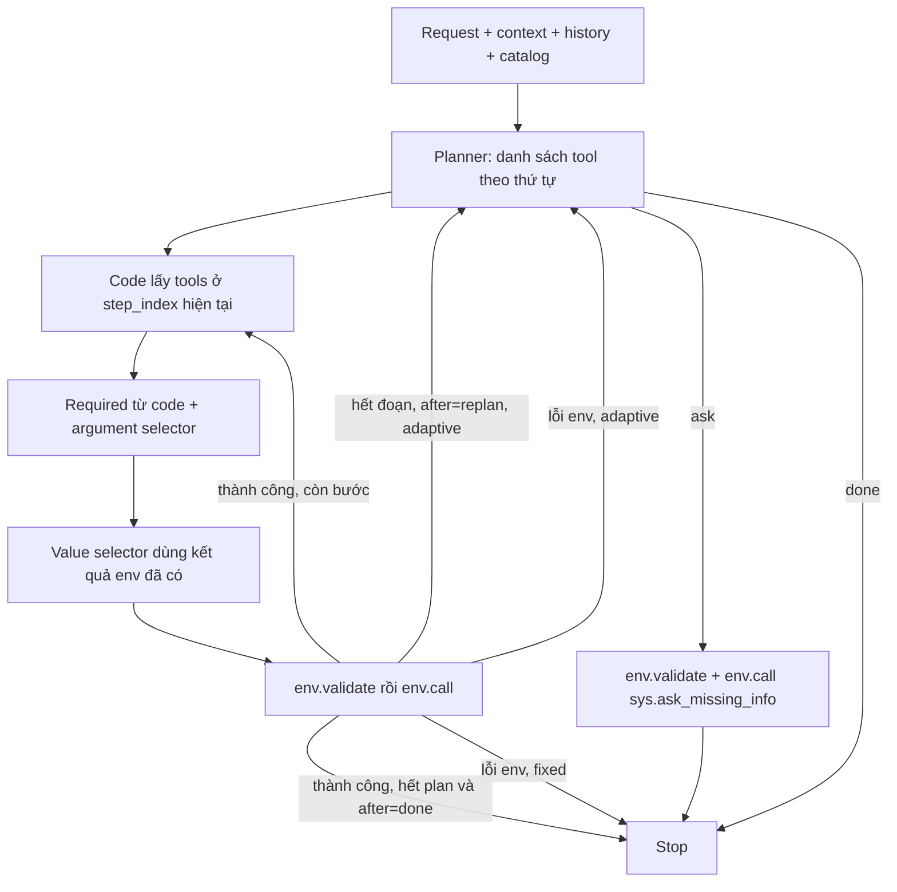

# Baseline v4: lập thứ tự tool trước khi thực thi

Biến thể riêng từ v3, giữ ba node **planner → argument selector → value selector**. Planner trả một danh sách tool đã sắp thứ tự; code chạy lần lượt từng tool. Không gọi planner cho từng tool như v3. V2 và v3 được giữ nguyên.

Ba node vẫn chỉ trả JSON, không có reason/note/task description/issue/goal bằng văn bản. Chỉ kết quả thật của `env.validate` và `env.call` được dùng làm feedback. Nội dung tin nhắn/ghi chú bên trong tool arguments vẫn là dữ liệu tác vụ được phép sinh.

## Workflow



Mỗi cạnh quay về planner mang response thật của môi trường, không có thông báo lỗi do Qwen viết thêm. Replan thay toàn bộ phần chưa thực thi; không giữ đuôi plan cũ để chạy tiếp sau một bước thất bại.

## Hai chế độ để thực nghiệm

| Chế độ | Planner | Khi env báo lỗi | Khi điều kiện quyết định tool chưa biết |
|---|---|---|---|
| `fixed` | Lập toàn bộ thứ tự một lần | Dừng, không chạy các bước sau | Không biểu diễn nhánh động; phải xác định được thứ tự hoặc ask để làm rõ |
| `adaptive` (mặc định) | Lập sẵn thứ tự; chỉ lập tiếp tại điểm đã khai báo hoặc lỗi env | Lập lại phần còn lại từ kết quả thật | Lập đoạn read để xác định điều kiện, rồi lập đoạn tiếp |

**Dùng `fixed` để thử đúng biến thể “lập một lần rồi chạy hết thứ tự”.** `adaptive` bổ sung khả năng xử lý tác vụ có nhánh phụ thuộc kết quả runtime. Đây là hai cấu hình khác nhau, không gộp metric khi so sánh.

Chưa biết ID không đồng nghĩa phải replan: planner có thể xếp lookup rồi write; value selector lấy ID khi write thực sự tới lượt. Chỉ khi kết quả read quyết định hành động/tool nào được phép chạy mới cần chia đoạn ở adaptive. Nếu hai nhánh cần hai tool khác nhau, không được xếp cả hai write rồi hy vọng value selector tự bỏ qua.

## Contract

Prompt: `agent.py`; schema decoder: `output_contracts.py`; executor: `agent_pipeline.py`.

Input chung: `request`, `context` (không có installed_apps/state ẩn), `history` ban đầu, `env_feedback`, `remaining_tool_calls`. Không đưa label, gold tool calls, final_state hoặc giải thích từ model vào prompt.

### Planner

Input thêm `available_tools`, `plan_mode`, và `previous_plan` khi có kế hoạch trước đó. `previous_plan` chỉ chứa tools/after cùng `next_step` do code theo dõi; đây là trạng thái điều khiển có cấu trúc, không phải lời tự đánh giá của model.

```json
{"type":"plan","tools":["<tool bước 1>","<tool bước 2>"],"after":"done"}
```

`tools` không rỗng, tên thuộc catalog được cấp, độ dài không vượt ngân sách env.call còn lại. Một tên được phép xuất hiện nhiều lần để phục vụ nhiều đối tượng. Thứ tự mảng chính là thứ tự gọi. Planner không điền args hoặc value.

Ở adaptive có thể trả:

```json
{"type":"plan","tools":["<tool đọc quyết định nhánh>"],"after":"replan"}
```

`after=done`: hết plan thành công thì code dừng, không gọi planner thêm để xác nhận done. `after=replan`: thực thi hết đoạn mới gọi planner tiếp. Chế độ fixed không chấp nhận after=replan.

Hai output khác:

```json
{"type":"ask","tool_name":"<tool đích>","params":["<field thật>"]}
```

```json
{"type":"done"}
```

Ask được chuyển thành sys.ask_missing_info. Done trực tiếp chỉ dùng khi không còn tool cần thực hiện.

### Argument selector

Input thêm schema đầy đủ `selected_tool`, `required_arguments`, `execution_plan` và `step_index` (0-based). Tool hiện tại là `execution_plan.tools[step_index]`. Node chỉ chọn field cho bước đó, không đổi tool/thứ tự hoặc lập lại plan.

```json
{"selected_arguments":["<field bổ sung>"]}
```

Hoặc `{"selected_arguments":[]}`. Code tự thêm required; Qwen chỉ chọn x-one-of và optional cần thiết. Không có field ngoài required thì bỏ qua lượt Qwen này. OR giữa nhóm x-one-of, AND giữa field trong một nhóm.

### Value selector

Input thêm `selected_tool`, `selected_arguments` cuối cùng, `execution_plan`, `step_index`. Node sử dụng kết quả tool đã thực thi trước bước hiện tại để điền value; không dự đoán kết quả của tool tương lai.

```json
{"arguments":{"<field đã chọn>":"<value đúng type>"}}
```

Chưa biết hoặc mơ hồ thì bỏ field, không bịa/null/sentinel/issue. Env.validate có thể trả lỗi thiếu required/x-one-of. Ở fixed lỗi này dừng mẫu; ở adaptive planner nhận chính response đó để chọn lookup hoặc ask. Nếu tập field rỗng, code dùng arguments={} và bỏ qua lượt value selector.

## Kiểm tra và feedback

Feedback giữ nguyên từng response:

```json
{"stage":"validate hoặc call","tool":"<tool>","arguments":{},"response":{}}
```

Env.validate chỉ kiểm schema; `ok=true, done=false` từ env.call vẫn là thất bại nghiệp vụ. V4 không biến message này thành thành công và không tự chạy bước tiếp theo.

Decoder vLLM mặc định dùng guidance, giới hạn key/tên tool/tên field theo schema. Parser chặn JSON không hoàn chỉnh, key trùng, NaN/Infinity, field ngoài contract. Local contract error dừng với `invalid_model_output`; diagnostic chỉ nằm trong trace, không được đưa lại model làm feedback.

Giữ budget, giới hạn lỗi/read lặp và chặn write giống hệt đã thành công. Lỗi hạ tầng/grammar/context vượt ngân sách làm experiment aborted, không được chấm như một kết quả agent bình thường. Context quá dài bỏ history cũ rồi feedback cũ, giữ request/schema/plan và feedback mới nhất; `context_trimmed` ghi nhận mất ngữ cảnh này.

## Chạy Kaggle hoặc CLI

Notebook `kaggle_runner.ipynb` dùng thư mục/output riêng `baseline_v4`. Bật GPU/Internet, attach code và dữ liệu, chọn:

```python
MODE = "workflow"
PLAN_MODE = "fixed"  # hoặc adaptive
INFERENCE_WORKERS = 4
VLLM_MAX_NUM_SEQS = INFERENCE_WORKERS
STRUCTURED_OUTPUTS = True
```

```bash
python baseline_v4/run.py --mode workflow --data-root train+public_test \
  --plan-mode fixed --limit 50 --seed 42 \
  --inference-workers 4 --vllm-max-num-seqs 4 \
  --output-dir lifemate_baseline_v4_fixed
```

Chạy adaptive ở output-dir khác để so sánh. Giữ cùng model, seed, sample IDs, budgets và số workers. Workers=1 để đo latency riêng; workers>1 để đo throughput. Batch gom request của các mẫu độc lập, không trộn plan, env hoặc prompt giữa các mẫu.

Giữ các mode asr/workflow/baseline/all, ASR cache, run_one và báo cáo như v3. Lượt planner/arg/val đều dùng chung Qwen; không thêm node LLM thứ tư. Dependency và inference adapter kế thừa v3.

## Trace và metric

- `plans`: các danh sách đã lập; `plan_mode`, `planner_calls`, `replans`, `execution_steps` ghi trong cases.csv.
- Trace tách `event_type=planning` và `event_type=execution`. Mỗi bước có plan_id/step_index; `node_outputs` có token/latency theo `plan`, `select_arguments`, `fill`.
- `decisions` đếm event lập kế hoạch và event thực thi, không còn cùng nghĩa với quyết định chọn một tool của v3. So chi phí bằng số lượt LLM, token, wall time và planner_calls.
- `replans` đếm các lượt gọi planner sau lượt đầu, kể cả lượt trả ask/done. Không có lượt xác nhận done cuối plan bình thường.
- Notebook `analyze_results.ipynb` hiển thị metric, plan và chi phí từng node.

## Kiểm thử và giới hạn

```bash
python -m pip install matplotlib jsonschema 'llguidance>=1.3,<1.4'
python -m unittest discover -s baseline_v4 -p 'test_*.py' -v
```

Kiểm thử CPU bằng scripted model và ToolEnv thật: chạy đúng thứ tự, full plan chỉ một lượt planner, read→replan→write, thiếu value/lỗi nghiệp vụ không chạy đuôi cũ, fixed dừng khi lỗi, nhiều lần cùng tool, duplicate guard, biên budget, batch isolation, schema và report.

Tests kiểm implementation; chưa có số liệu Qwen v4 trên GPU. Ít lượt planner có thể giảm chi phí nhưng chưa chứng minh nhanh hơn hoặc chính xác hơn. Sai một plan có thể kéo theo nhiều bước sai. Kế hoạch chỉ gồm tên tool nên khi cùng tool lặp nhiều lần, arg/val phải suy ra đối tượng từ request, step_index và feedback; chưa có ánh xạ task→step tường minh. Env cũng không phát hiện hết value sai ngữ nghĩa hoặc optional quan trọng bị bỏ. Hết plan không chứng minh đã làm đủ request, và adaptive có thể chia đoạn quá nhỏ; cần đo planner_calls/replans cùng score.
