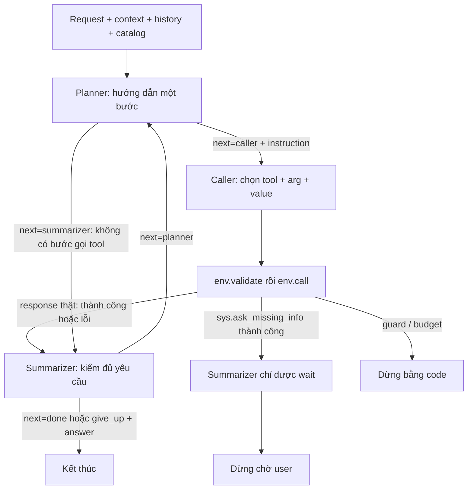

# Baseline v7 — planner → caller (tool + arg + value) → summarizer

V7 có ba vai trò dùng cùng Qwen checkpoint, chưa fine-tune:

1. **Planner** hướng dẫn một bước tiếp theo, không chọn cố định tool và không quyết định kết thúc.
2. **Caller** chọn một tool cùng toàn bộ arguments và values cho bước đó.
3. **Summarizer** đối chiếu kết quả thật với toàn bộ yêu cầu, rồi kết luận hoặc quay lại planner.

Đây là biến thể mới dựa trên v6. Không sửa v5/v6 và không import chúng làm dependency. Summarizer nhận observation gốc; không thay lịch sử môi trường bằng bản tóm tắt tự sinh.

## Workflow



Đường chính là planner → caller → môi trường → summarizer. Planner có thể chuyển thẳng summarizer khi không cần gọi tool hoặc muốn đề nghị kết thúc; summarizer có thể từ chối đề nghị này và yêu cầu tiếp tục. Mỗi round chỉ có tối đa một caller/tool call.

Summarizer là node kiểm hoàn tất và kết luận, **không phải node nén memory, sinh critique hoặc tự tạo dữ liệu huấn luyện**. Khi tiếp tục, planner nhận raw env_feedback và tín hiệu điều phối, không nhận câu kết luận hoặc ghi chú do summarizer viết.

## Contract ba node

Prompts nằm riêng trong [src/lifemate_v7/prompts/](src/lifemate_v7/prompts/). Contract decoder ở [contracts.py](src/lifemate_v7/contracts.py), điều phối ở [pipeline.py](src/lifemate_v7/pipeline.py).

Input chung:

| Field | Format và ý nghĩa |
|---|---|
| `request` | String: yêu cầu hiện tại; gold transcript trong workflow mode, ASR trong baseline mode |
| `context` | Object: thời gian, múi giờ, hồ sơ được cấp; bỏ installed_apps/state ẩn |
| `history` | Array: hội thoại/tool results trước yêu cầu này; không tự phát lại nhiệm vụ cũ |
| `env_feedback` | Array response thật đã xảy ra từ env.validate/env.call, giữ cả thành công và lỗi |
| `remaining_tool_calls` | Integer: số env.call còn lại; không phải bằng chứng task đã hoàn thành |

Không đưa label, gold calls, final_state hoặc kết quả tool tương lai vào prompt. Catalog chỉ gồm tool thuộc app được cấp. Dữ kiện trong history có thể dùng để giải tham chiếu; yêu cầu hiện tại và câu sửa cuối quyết định nhiệm vụ còn hiệu lực.

### Planner

Nhận thêm:

- `available_tools`: catalog rút gọn gồm name/kind/description/input_fields/required/x-one-of/returns.
- `previous_review`: null ở đầu; `{"next":"planner"}` sau khi summarizer yêu cầu tiếp tục. Đây chỉ là metadata điều phối, không phải observation.

Output:

```json
{"next":"caller","instruction":"<mục tiêu cụ thể của một bước tiếp theo>"}
```

Hoặc:

```json
{"next":"summarizer"}
```

Instruction một câu, tối đa 240 ký tự, không xuống dòng. Không có tool whitelist, arguments JSON, danh sách toàn bộ plan, rationale/reason/note/issue hoặc quyền done/give_up.

Planner giữ các hành động/đối tượng còn thiếu, giải điều kiện bằng dữ kiện đã có, đặt lookup trước write và không lặp hành động đã thành công. Nếu thiếu thông tin mà có thể hỏi user thì hướng dẫn caller dùng sys.ask_missing_info. Sau lỗi env, planner có thể chọn bước xử lý khác có căn cứ.

### Caller

Nhận thêm:

- `planner_instruction`: instruction hiện tại, không phải bằng chứng về ID/giá trị/thành công.
- `available_tools`: schema đầy đủ của toàn bộ catalog được cấp. Không có tập tool khóa từ đầu.

Output:

```json
{"name":"<tool khả dụng>","arguments":{"<input field>":"<value đúng type>"}}
```

Tool không có field cần truyền:

```json
{"name":"<tool khả dụng>","arguments":{}}
```

Cần hỏi:

```json
{"name":"sys.ask_missing_info","arguments":{"tool_name":"<tool đích>","params":["<input field thật>"]}}
```

Caller tự chọn tool, required, đủ một nhóm x-one-of (OR giữa các nhóm, AND trong nhóm), optional phù hợp và values trong cùng output. Code không tự điền value hộ. Không có node arg/val riêng, caller không được done/give_up hoặc viết feedback.

Values phải có căn cứ đúng đối tượng, namespace và bản ghi. Không lấy returns làm input, dựng ID/số tiền/số điện thoại hoặc thêm filter làm đổi phạm vi. Thiếu dữ kiện thì lookup hoặc hỏi; không dùng lời planner thay observation.

### Summarizer

Nhận thêm:

| Field | Format và ý nghĩa |
|---|---|
| `available_tools` | Catalog ngắn chỉ name/kind/description, để biết phạm vi khả năng |
| `current_step` | Object chứa planner_output và action của round hiện tại nếu có; đây là đề xuất model, không phải bằng chứng thành công |
| `waiting_for_user` | Boolean do code đặt sau sys.ask_missing_info thành công |

Summarizer kiểm mọi hành động áp dụng, từng đối tượng, nhánh, kênh, phủ định và mốc thời gian. Read không chứng minh write; một write thành công không chứng minh tất cả yêu cầu đã xong; ok=true/done=false vẫn là thất bại.

Output khi còn bước hữu ích:

```json
{"next":"planner"}
```

Đã hoàn thành:

```json
{"next":"done","answer":"<kết luận đúng kết quả đã có>"}
```

Không thể hoàn thành bằng khả năng được cấp hoặc không thể khắc phục tác động sai:

```json
{"next":"give_up","answer":"<nêu kết quả/giới hạn thực tế>"}
```

Sau khi hỏi thông tin user thành công:

```json
{"next":"wait","answer":"<thông tin user cần bổ sung>"}
```

Answer tiếng Việt, một câu tối đa 480 ký tự, không xuống dòng. Chỉ sinh answer ở terminal output; next=planner không có answer/summary/critique/instruction. Câu cuối không đưa lại vào env_feedback hoặc planner.

Khi waiting_for_user=true, schema **chỉ cho phép wait**. Khi false, không được wait. Không được báo done vì hết budget, planner đề nghị kết thúc, một tool thành công hoặc có lỗi khó xử lý.

`final_answer` được lưu trong report, không thêm vào prediction submission vốn chỉ gồm id/tool_calls/state_hash. Metric proxy/hash chưa đánh giá câu kết luận cuối.

## Feedback, phục hồi và guard

Chỉ ToolEnv response thật được ghi thành observation:

```json
{"stage":"validate hoặc call","tool":"<tool>","arguments":{},"response":{}}
```

Khác v6, lỗi env không tự động dừng ngay:

- env.validate từ chối: không gọi tool đó; giữ response lỗi để summarizer xét tiếp tục hoặc give_up.
- env.call trả ok=false hoặc done=false: giữ nguyên thất bại, tăng tool_failures; summarizer có thể quay planner chọn bước xử lý khác.
- Không có retry tự động ở caller; một lần thử sau lỗi cần đi qua summarizer → planner → caller.
- Lỗi JSON/contract do model hoặc hạ tầng không được biến thành response env giả. Sai contract dừng invalid_model_output; backend/grammar/context error làm experiment aborted.

Code vẫn có quyền dừng vượt budget, write trùng đã thành công, read lặp, cùng lỗi env lặp và planner/summarizer handoff liên tiếp mà không gọi tool. Các guard có thể dừng trước khi chạy summarizer; khi đó final_answer có thể null.

`--max-no-progress=2`: với chuỗi read/lỗi giống nhau, lần đầu ghi nhận dữ kiện, lần thứ hai còn được review, lần thứ ba bị chặn vì đã lặp hai lần. Handoff không có tool bị chặn khi vượt hai round liên tiếp. Local diagnostic chỉ nằm trong trace, không giả làm observation.

`--max-tool-calls=10` tính mọi env.call, kể cả call thất bại và sys.ask_missing_info. Validation thất bại không tiêu thụ env.call. `--max-decisions=24` là số round, mỗi round có một planner, tối đa một caller và một summarizer; không phải tổng số requests LLM.

Khi budget tool hết, summarizer của call cuối vẫn được kết luận. Nếu còn yêu cầu gọi tiếp, code ghi tool_limit, không ép model done bằng grammar. Hết round mà summarizer vẫn yêu cầu tiếp tục thì decision_limit.

Context dài được cắt history cũ rồi feedback cũ; giữ request/schema/instruction hoặc current_step, cùng observation mới nhất. `context_trimmed` ghi nhận mất dữ kiện. Không có model-generated memory summary.

## Chạy Kaggle và CLI

Mở [notebooks/kaggle_runner.ipynb](notebooks/kaggle_runner.ipynb), bật GPU/Internet, attach dữ liệu và toàn bộ baseline_v7. Giữ nguyên src/ và ba prompt assets.

```python
MODE = "workflow"
INFERENCE_WORKERS = 4
VLLM_MAX_NUM_SEQS = INFERENCE_WORKERS
MAX_TOOL_CALLS = 10
MAX_DECISIONS = 24
STRUCTURED_OUTPUTS = True
SAVE_NODE_INPUTS = False
```

```bash
python baseline_v7/run.py --mode workflow --data-root train+public_test \
  --limit 50 --seed 42 --inference-workers 4 --vllm-max-num-seqs 4
```

Giữ các mode asr/workflow/baseline/all và run_one.py. Local output mặc định baseline_v7/outputs; Kaggle output /kaggle/working/lifemate_baseline_v7. Có thể đặt --output-dir.

Ba vai trò dùng chung model/engine. Batch gom node requests từ các mẫu độc lập; mỗi mẫu giữ env, current_step, instruction, schema và vòng điều phối riêng. workers=1 đo latency riêng; workers>1 đo throughput.

Với N tool calls thành công và summarizer kết luận ngay sau call cuối, thông thường cần **3N lượt Qwen**, không có lượt planner done cuối như v6. Request không cần tool dùng planner → summarizer (2 lượt). Các handoff, lần sửa lỗi và guard làm thay đổi số lượt; so bằng llm_calls cùng wall time, không chỉ decisions. V7 thêm chi phí summarizer, không mặc định nhanh hơn v6.

## Cấu trúc và report

```text
baseline_v7/
├── run.py / run_one.py
├── src/lifemate_v7/
│   ├── pipeline.py / contracts.py
│   ├── prompts/{planner,caller,summarizer}.txt
│   ├── models.py / batching.py
│   ├── runner.py / common.py / reporting.py
│   └── errors.py / reproducibility.py
├── notebooks/{kaggle_runner,analyze_results}.ipynb
├── requirements/{vllm,transformers,test}.txt
├── tests/
└── docs/workflow.mmd
```

run_config/summary ghi architecture=planner_caller_summarizer, termination_owner=summarizer, environment_error_policy=review_by_summarizer, seed/model/batch/sample IDs và fingerprint gồm toàn bộ Python/prompt assets.

Trace có planner_output/action/summarizer_output và node_outputs.plan/call/summarize. Cases/summary ghi planner_calls, caller_calls, summarizer_calls, llm_calls, token/latency, lỗi và final_answer. Có thể có ít summarizer hơn planner khi guard chặn giữa round.

[notebooks/analyze_results.ipynb](notebooks/analyze_results.ipynb) hiển thị chi phí từng vai trò và đầy đủ trace. Bật --save-node-inputs để lưu exact input_messages. Chưa tự lọc trajectory, tạo nhãn hoặc fine-tune; instruction và answer là các target cần cân nhắc khi tạo dữ liệu huấn luyện.

## Kiểm thử và giới hạn

```bash
python -m pip install -r baseline_v7/requirements/test.txt
python -m unittest discover -s baseline_v7/tests -p 'test_*.py' -v
```

Tests CPU dùng model giả lập, ToolEnv thật và guidance thật: chuỗi ba node, summarizer bác handoff sớm, caller full catalog, ask buộc wait, lỗi validate/business quay planner, guard, budgets, schema/contract, batch isolation, report và entry points. Đây là kiểm tra implementation, không phải benchmark Qwen trên GPU.

Summarizer vẫn dùng cùng checkpoint nên có thể lặp lại sai sót của planner/caller. Schema hợp lệ không kiểm chứng ID/nhánh/ngữ nghĩa, và env có thể chấp nhận value sai. Quyết định done hoặc câu answer cũng có thể sai; chưa có verifier độc lập. Recovery không đảm bảo sửa được tác động đã xảy ra. Cần chạy cùng sample IDs/model/GPU/worker settings để đánh giá chất lượng và chi phí so với v6; đây không phải tái lập đầy đủ phương pháp fine-tune trong paper.
