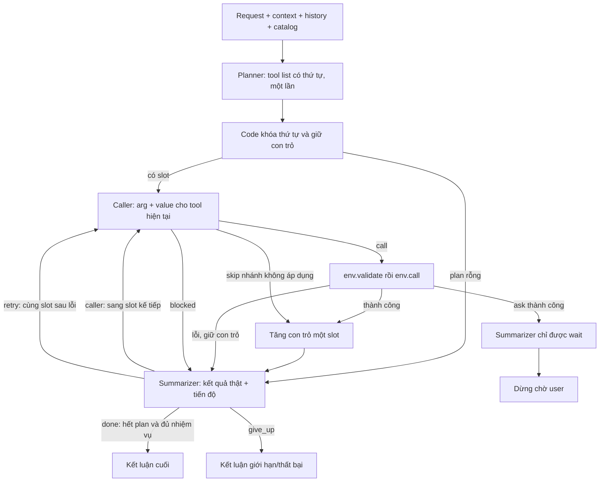

# Baseline v8 — planner chọn tool + thứ tự → caller arg/value → summarizer

V8 kết hợp plan có thứ tự của v5 và node kiểm hoàn tất của v7, trong một package độc lập:

1. **Planner chạy một lần:** chọn danh sách tool và thứ tự cho toàn bộ request.
2. **Caller:** chỉ chọn arguments và values cho đúng tool tại vị trí hiện tại.
3. **Summarizer:** đối chiếu kết quả thật, cho sang slot tiếp theo, retry cùng slot sau lỗi, hoặc kết luận.

Không quay lại planner, không mở rộng/sắp lại plan. Các baseline v5/v6/v7 được giữ nguyên và không phải dependency. Ba vai trò dùng chung Qwen checkpoint; chưa fine-tune.

## Workflow



Mỗi phần tử của plan là **một slot**, có thể lặp tên tool cho nhiều đối tượng/lần gọi. Code không sort hay deduplicate plan. Values chỉ được tạo tại runtime sau khi các lookup trước đó đã thực thi.

Summarizer không có quyền nhảy slot, sửa tool hoặc replan. Để tránh kết thúc sớm, schema chỉ cho phép done khi con trỏ đã đến cuối plan. Khi đó model vẫn phải kiểm nhiệm vụ thật đã đủ; plan thiếu bước hoặc skip sai cần give_up, không tự tạo bước mới.

## Input chung và nguồn dữ kiện

| Field | Format và ý nghĩa |
|---|---|
| `request` | String: yêu cầu hiện tại; gold transcript ở workflow mode, ASR ở baseline mode |
| `context` | Object: thời gian/múi giờ/hồ sơ được cấp; loại installed_apps/state nội bộ |
| `history` | Array hội thoại/tool results trước request; không tự phát lại nhiệm vụ cũ |
| `remaining_tool_calls` | Integer: số env.call còn lại, không phải bằng chứng đã hoàn thành |

Không đưa label, gold calls, final_state hoặc observation tương lai vào model. Catalog chỉ lấy tool thuộc app được cấp. Các metric dùng nhãn chỉ tính offline sau inference.

Ở caller/summarizer, `env_feedback` chỉ chứa response thật:

```json
{"stage":"validate hoặc call","tool":"<tool>","arguments":{},"response":{}}
```

`step_results`, `caller_output`, `action`, `previous_review` là metadata/đề xuất của agent, không phải bằng chứng nghiệp vụ. Không dùng câu kết luận hoặc critique do summarizer sinh làm observation cho caller.

## Contract planner

Input thêm:

- `available_tools`: catalog rút gọn với name/kind/description/input_fields/required/x-one-of/returns.
- `max_plan_steps`: số slot tối đa.

Planner chỉ chạy trước lần tương tác tool đầu tiên, không nhận env_feedback runtime. Output:

```json
{"tools":["<tool ở bước đầu>","<tool ở bước kế tiếp>"]}
```

Hoặc:

```json
{"tools":[]}
```

Chỉ một key tools: array có thứ tự, tên hợp lệ, được trùng tên. Không argument/value, instruction/task description hoặc reason/note/issue/CoT. `sys.ask_missing_info` không nằm trong plan nghiệp vụ; caller có contract hỏi input của slot hiện tại.

Planner phải đặt lookup trước các bước cần ID/dữ kiện và bao quát mọi hành động, đối tượng, kênh, điều kiện, phủ định và câu sửa cuối. Với nhánh chưa biết, đặt lookup kiểm tra trước các bước phụ thuộc; caller chỉ thực hiện nhánh áp dụng và skip các slot còn lại theo thứ tự.

Plan rỗng vẫn qua summarizer, không tự coi là thành công.

## Contract caller

Input thêm:

| Field | Format và ý nghĩa |
|---|---|
| `tool_plan` | Array tên tool gốc, giữ thứ tự và phần tử lặp |
| `step_index` | Integer từ 0: slot hiện tại chưa hoàn tất |
| `selected_tool` | Schema đầy đủ của đúng tool_plan[step_index]; không có catalog cho caller tự đổi tool |
| `remaining_plan_steps` | Số slot chưa xử lý, gồm slot hiện tại |
| `step_results` | Array metadata `{step_index, tool, status}` với executed/skipped |
| `previous_review` | null hoặc `{next: caller/retry}`, chỉ là tín hiệu điều phối |
| `env_feedback` | Response thật của những lần validate/call đã xảy ra |

Output một trong:

```json
{"type":"call","arguments":{"<input field>":"<value đúng type>"}}
```

```json
{"type":"call","arguments":{}}
```

```json
{"type":"skip"}
```

```json
{"type":"ask","params":["<input field thật của tool hiện tại>"]}
```

```json
{"type":"blocked"}
```

- **call:** caller chọn mọi required, đủ ít nhất một nhóm x-one-of (OR giữa nhóm, AND giữa field trong nhóm), optional cần thiết và values. Code gắn tên tool, không điền value hộ.
- **skip:** chỉ khi nhánh được xác định không áp dụng hoặc chính hành động đã hoàn tất đúng; không skip vì thiếu giá trị hay để nhảy tới lookup đặt sau. Không env.call, không response giả.
- **ask:** code gắn target bằng tool hiện tại, gọi sys.ask_missing_info thật. params là field hợp lệ, không trùng/rỗng. Không có câu hỏi tự do ở caller.
- **blocked:** không thể xử lý bước mà không đổi kế hoạch và không có field thích hợp để hỏi. Summarizer kết luận give_up.

Không có name/tool_name/done ở cấp điều khiển caller. Các field nghiệp vụ tên name/note vẫn được phép bên trong arguments nếu có trong schema. Values phải đúng nguồn, namespace, bản ghi, type/enum/đơn vị/thời gian; không bịa ID/số tiền/địa chỉ/số điện thoại hoặc tự thêm filter làm mất phạm vi.

## Contract summarizer

Input thêm:

- `tool_plan`, `step_index`, `remaining_plan_steps`, `step_results` và env_feedback như trên. Con trỏ **đã tăng** sau call thành công/skip, giữ nguyên sau lỗi/ask/blocked.
- `current_step`: step_index của lượt vừa xử lý, selected_tool, caller_output/action nếu có.
- `step_status`: trạng thái thực tế do code gắn.
- `waiting_for_user`: true sau sys.ask_missing_info thành công.
- `available_tools`: catalog ngắn name/kind/description để hiểu khả năng, không cho phép mở rộng plan.

Route được schema và runtime kiểm theo trạng thái:

| Trạng thái | Output hợp lệ |
|---|---|
| executed/skipped, còn slot | caller hoặc give_up |
| executed/skipped, hết slot | done hoặc give_up |
| empty_plan | done hoặc give_up |
| validation_failed/tool_failed/ask_failed | retry hoặc give_up; con trỏ giữ nguyên |
| blocked | chỉ give_up |
| waiting_for_user | chỉ wait |

Output:

```json
{"next":"caller"}
```

```json
{"next":"retry"}
```

```json
{"next":"done","answer":"<kết luận đúng kết quả thực tế>"}
```

```json
{"next":"give_up","answer":"<phần đã làm/chưa làm và giới hạn thực tế>"}
```

```json
{"next":"wait","answer":"<thông tin user cần bổ sung>"}
```

Answer tiếng Việt, một câu tối đa 480 ký tự, không xuống dòng; chỉ ở terminal output. caller/retry không có answer/summary/critique. Không có next=planner, tên tool hoặc con trỏ do model sinh.

Done đòi hỏi **cả hết plan lẫn hoàn thành đủ ý định**. Code chỉ kiểm được điều kiện hết plan; kiểm ngữ nghĩa vẫn phụ thuộc summarizer. Read không thay write, ok=true/done=false chưa thành công, gửi tin thành công chưa chứng minh đúng người nếu ID không có căn cứ. Không gộp việc đã thanh toán với việc đã nhắn tin, hoặc một đối tượng với tất cả đối tượng.

Nếu hết plan nhưng thiếu hành động cần thiết, không có tool để tiếp tục: give_up và nêu phần chưa xong. Không ép done khi hết budget. final_answer chỉ lưu trong report; submission giữ id/tool_calls/state_hash và metric hiện tại chưa chấm câu trả lời cuối.

## Lỗi, retry và budget

Env.validate luôn trước env.call. Validation lỗi không thực thi tool. Env.call ok=false hoặc done=false ghi nhận thất bại, kể cả ok=true/done=false. Summarizer nhận nguyên response lỗi để chọn:

- retry đúng slot/tool nếu có căn cứ sửa arg/value hoặc hỏi input thiếu;
- give_up nếu không thể sửa trong bước hiện tại hoặc cần lookup/tool chưa có trước bước đó.

Không retry sau call đã thành công, không gọi lại planner, không chèn lookup và không tiến con trỏ qua bước thất bại. Mỗi retry cần một lượt caller và summarizer mới, không phải retry tự động trong backend. Cùng lỗi lặp bị guard chặn.

Giữ chặn write giống hệt đã thành công, read lặp và budget. `--max-no-progress=2`: response đầu được ghi nhận, lần lặp đầu còn được review, lần lặp thứ hai bị chặn trước summarizer. Sai JSON/contract dừng invalid_model_output; lỗi engine/grammar/context làm experiment aborted, không tạo summary thành công giả. Các guard có thể dừng trước summarizer và để final_answer=null.

Budgets độc lập:

- `--max-plan-steps` (24): số slot đầu ra planner, gồm nhánh có thể skip.
- `--max-tool-calls` (10): tổng env.call, kể cả thất bại và ask. Skip/validation không tính.
- `--max-decisions` (24): một planner event ban đầu + các caller/summarizer attempts, gồm retry. Không phải tổng requests Qwen.

Cần ít nhất 1 + số slot + số retry events để duyệt hết một plan. Nếu plan dài bằng max_decisions, budget có thể hết trước slot cuối; không sửa plan hoặc giả vờ hoàn thành. Caller vẫn có thể skip nhánh không áp dụng khi tool budget bằng 0; call/ask tiếp sẽ dừng tool_limit.

Prompt dài được cắt history cũ rồi feedback cũ, giữ request/plan/schema hoặc current_step và observation mới nhất; context_trimmed ghi nhận mất dữ kiện. Không có model-generated memory summary.

## Chạy Kaggle và CLI

Mở [notebooks/kaggle_runner.ipynb](notebooks/kaggle_runner.ipynb), bật GPU/Internet, attach dữ liệu và toàn bộ baseline_v8_finetune. Giữ nguyên src/ và ba prompt assets.

```python
MODE = "workflow"
INFERENCE_WORKERS = 4
VLLM_MAX_NUM_SEQS = INFERENCE_WORKERS
MAX_PLAN_STEPS = 24
MAX_TOOL_CALLS = 10
MAX_DECISIONS = 24
STRUCTURED_OUTPUTS = True
SAVE_NODE_INPUTS = False
```

```bash
python baseline_v8_finetune/run.py --mode workflow --data-root train+public_test \
  --limit 50 --seed 42 --inference-workers 4 --vllm-max-num-seqs 4 \
  --max-plan-steps 24 --max-tool-calls 10 --max-decisions 24
```

Giữ asr/workflow/baseline/all, run_one.py, batching và các backend vLLM/Transformers. Local output baseline_v8_finetune/outputs; Kaggle output /kaggle/working/lifemate_baseline_v8_finetune. Có thể đổi --output-dir.

Batch gom node requests giữa các mẫu độc lập; mỗi mẫu giữ ToolEnv, plan, con trỏ, schema và retry state riêng. workers=1 đo latency riêng; workers>1 đo throughput. Ba vai trò dùng chung model/engine.

Với N caller attempts/skip xử lý đến kết thúc, thường cần **1 + 2N lượt Qwen** (1 planner + N caller + N summarizer). Retry thêm hai lượt mỗi lần; guard có thể dừng trước summarizer. Plan rỗng dùng planner + summarizer = 2 lượt. Chưa có số liệu GPU chứng minh v8 nhanh/chính xác hơn; so bằng cùng mẫu/model/GPU/batch settings, wall time và llm_calls.

## Layout và report

```text
baseline_v8_finetune/
├── run.py / run_one.py
├── src/lifemate_v8_finetune/
│   ├── pipeline.py / contracts.py
│   ├── prompts/{planner,caller,summarizer}.txt
│   ├── runner.py / common.py / reporting.py
│   ├── models.py / batching.py
│   └── errors.py / reproducibility.py
├── notebooks/{kaggle_runner,analyze_results}.ipynb
├── requirements/{vllm,transformers,test}.txt
├── tests/
└── docs/{workflow.mmd,validation.json}
```

run_config/summary ghi architecture=ordered_plan_caller_summarizer, tool_order=fixed_by_planner, caller_tool_choice=false, termination_owner=summarizer, environment_error_policy=retry_current_step_or_give_up và fingerprint gồm Python/prompt assets.

Trace có planner_output/tool_plan và từng slot với step_index/selected_tool/caller_output/action/step_status/summarizer_output. node_outputs dùng plan/call/summarize. final_answer và số lượt từng node được lưu ở trace/cases/summary.

Diagnostic offline:

- selected_tools: các tên duy nhất theo lần xuất hiện đầu; không dùng để điều phối.
- plan_step_count: số slot, tính tên lặp; processed_steps: số slot thành công hoặc skip; skipped_steps: phần bị skip.
- retry_requests: số yêu cầu retry đã chấp nhận; không đảm bảo retry đã chạy nếu hết event budget.
- tool_set_recall: coverage tên tool trong gold, bỏ sys.ask_missing_info.
- tool_order_recall: LCS giữa plan và gold tool-name sequence / số gold calls nghiệp vụ, tính cả tên lặp.
- tool_plan_exact_match: chuỗi tên tool giống gold nghiệp vụ.

Các metric plan không thay audit ngữ nghĩa; plan có nhánh bị skip hoặc các read đổi thứ tự tương đương có thể khác gold dù thực thi đúng. Proxy là metric local xấp xỉ, không phải điểm leaderboard. Label không đưa vào model.

[notebooks/analyze_results.ipynb](notebooks/analyze_results.ipynb) hiển thị plan, tiến độ, retry, chi phí ba node và trace. --save-node-inputs lưu exact prompts để tạo dữ liệu huấn luyện sau; không tự chọn trajectory, tạo nhãn hay fine-tune.

## Kiểm thử và giới hạn

```bash
python -m pip install -r baseline_v8_finetune/requirements/test.txt
python -m unittest discover -s baseline_v8_finetune/tests -p 'test_*.py' -v
```

CPU tests dùng model giả lập, ToolEnv thật và guidance thật: thứ tự/tên lặp, caller bị khóa tool, lookup trước values, skip, ask buộc wait, done không sớm, retry giữ slot, lỗi không tự advance, guard/budgets, batch isolation, report, notebooks/entry points và schema compilation.

Plan cố định không xử lý được mọi phụ thuộc runtime: chưa có foreach cho số đối tượng chỉ biết sau lookup, nhãn mục tiêu/guard cho từng slot hoặc replan. Các slot cùng tool ở nhiều nhánh có thể mơ hồ. Schema không kiểm chứng grounding, và summarizer cùng checkpoint vẫn có thể tin value/skip sai. Hết plan không chứng minh đủ nhiệm vụ; tác động sai có thể không khắc phục được. Cần thực nghiệm Qwen trên GPU để đánh giá phương pháp; CPU tests chỉ xác nhận implementation.
